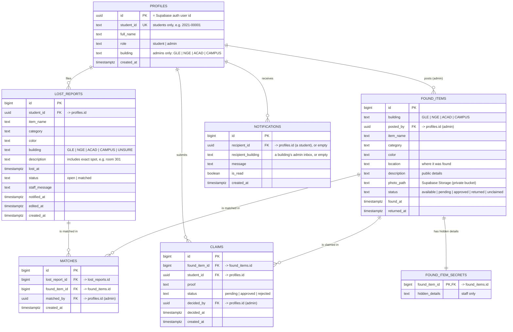

# Database Design (ERD) – Campus Lost and Found System

Phase 2 database for Supabase (PostgreSQL). It stores everything the app keeps in the browser today, plus real accounts and stricter privacy for found items.

## Diagram

## Tables

### `profiles`: one row per account
| Column | Type | Notes |
|---|---|---|
| `id` | uuid, PK | Same id as the Supabase Auth user |
| `student_id` | text, unique | Students only (e.g. `2021-00001`) |
| `full_name` | text | Shown to staff on reports and claims |
| `role` | text | `student` or `admin` |
| `building` | text | Admins only: `GLE`, `NGE`, `ACAD`, `CAMPUS` (CIT-U admin) |
| `created_at` | timestamptz | |

### `lost_reports`: what students lost
| Column | Type | Notes |
|---|---|---|
| `id` | bigint, PK | |
| `student_id` | uuid, FK → profiles | Who reported it |
| `item_name`, `category`, `color` | text | |
| `building` | text | `GLE`, `NGE`, `ACAD`, `CAMPUS`, or `UNSURE` (Not sure → all admins see it) |
| `description` | text | Brand, marks, contents, exact spot |
| `lost_at` | timestamptz | Can't be in the future |
| `status` | text | `open` (waiting for staff) or `matched` |
| `staff_message` | text | Optional note from staff when notifying |
| `notified_at`, `edited_at`, `created_at` | timestamptz | |

### `found_items`: what staff recorded
| Column | Type | Notes |
|---|---|---|
| `id` | bigint, PK | |
| `building` | text | Building of the admin who posted it |
| `posted_by` | uuid, FK → profiles | The admin |
| `item_name`, `category`, `color` | text | |
| `location` | text | Where it was found |
| `description` | text | Details anyone could see on the item |
| `photo_path` | text | File path in the private `found-photos` bucket |
| `status` | text | `available`, `pending` (claim in review), `approved` (ready for pickup), `returned`, `unclaimed` |
| `found_at`, `returned_at` | timestamptz | |

### `found_item_secrets`: hidden verification details (staff only)
| Column | Type | Notes |
|---|---|---|
| `found_item_id` | bigint, PK + FK → found_items | One row per item |
| `hidden_details` | text | Used to check a student's proof |

Kept in its **own table** so the database can give students access to their matched items without ever exposing the hidden details.

### `matches`: which found items staff matched to a report
| Column | Type | Notes |
|---|---|---|
| `id` | bigint, PK | |
| `lost_report_id` | bigint, FK → lost_reports | |
| `found_item_id` | bigint, FK → found_items | |
| `matched_by` | uuid, FK → profiles | The admin who matched it |
| `created_at` | timestamptz | |

Unique on (`lost_report_id`, `found_item_id`). Replaces the `matched: [ids]` list in the app, so one "Not sure" report can have matches from several buildings.

### `claims`: a student's request to take an item
| Column | Type | Notes |
|---|---|---|
| `id` | bigint, PK | |
| `found_item_id` | bigint, FK → found_items | |
| `student_id` | uuid, FK → profiles | |
| `proof` | text | At least 10 characters |
| `status` | text | `pending`, `approved`, `rejected` |
| `decided_by` | uuid, FK → profiles | Admin who approved/rejected |
| `decided_at`, `created_at` | timestamptz | |

### `notifications`
| Column | Type | Notes |
|---|---|---|
| `id` | bigint, PK | |
| `recipient_id` | uuid, FK → profiles | Set for a student's notice |
| `recipient_building` | text | Set for a building admin's inbox (e.g. `GLE`) |
| `message` | text | |
| `is_read` | boolean | |
| `created_at` | timestamptz | |

Exactly one of `recipient_id` / `recipient_building` is set.

## Who can see what (Row Level Security)

| Table | Students | Building admins |
|---|---|---|
| `profiles` | Their own row | All rows (to see names) |
| `lost_reports` | Their own reports; edit only while `open` | Reports for their building **or** `UNSURE` |
| `found_items` | **Only items matched to their own reports** | Items of their own building |
| `found_item_secrets` | **Never** | Their own building's items |
| `matches` | Matches on their own reports | Create/remove for their own items |
| `claims` | Create for a matched, available item; see their own | Claims for their own building's items |
| `notifications` | Their own | Their building's inbox |
| Photos (`found-photos` bucket) | Photos of items matched to them | Their own building's photos |

These rules make the professor's rule hold **in the database**, not just in the UI: even a student using the browser's developer tools can't list found items or read hidden details.

## From the app today → database

| App (`store.js`) | Database |
|---|---|
| `accounts` (with plain passwords) | Supabase Auth (hashed passwords) + `profiles` |
| `items[].hidden` | `found_item_secrets.hidden_details` |
| `items[].photo` (image stored as text) | Photo file in Storage, path in `found_items.photo_path` |
| `lost[].matched` (list of ids) | `matches` rows |
| `notes[]` with owner `#staff:GLE` | `notifications.recipient_building = 'GLE'` |
| `ownerName` copies on reports/claims | Looked up from `profiles.full_name` (no copies to keep in sync) |
